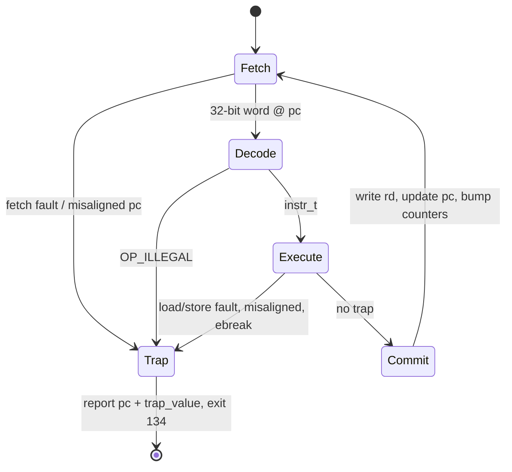
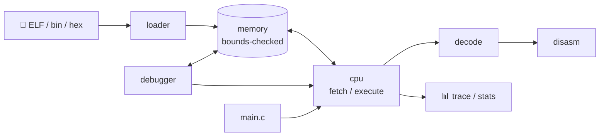

<div align="center">

```text
 ____   ___  ____   _  __        __     __
|  _ \ |_ _|/ ___| | |/ /        \ \   / /
| |_) | | | \___ \ | ' /  _____   \ \ / /
|  _ <  | |  ___) || . \ |_____|   \ V /
|_| \_\|___||____/ |_|\_\           \_/
```

### A modular, bounds-checked **RV32I Instruction Set Simulator** in strict C99

*Fetch → Decode → Execute → Write-back. Real ELF binaries. Zero host crashes.*


[Demo](#-demo) · [Features](#-features) · [How it works](#-how-it-works) · [Memory safety](#-memory-safety) · [Debugger](#-interactive-debugger) · [Quick start](#-quick-start) · [Roadmap](#-roadmap)

</div>

---

##  Demo

```console
$ make && ./build/riskv examples/hello.hex
Hello, RISC-V!

$ ./build/riskv -s examples/sum.hex ; echo $?
...
instructions retired : 35
branches taken       : 9 / 10
55

$ ./build/riskv examples/fault.hex
[riskv] TRAP: load access fault at pc=0x80000004 (value=0x00000000) after 1 instructions
[riskv]   faulting instruction: 00002503  lw a0, 0(zero)
```

RISK-V emulates the CPU core, the 32-entry register file, and byte-addressable little-endian main memory of a RISC-V RV32I processor. It runs real `riscv32` **ELF binaries**, flat binaries, and hand-written **hex programs**.

---

##  Explain it simply

Think of a **video game console emulator**, the kind that lets you play old Nintendo games on your laptop. This project does the same thing, but for a **processor chip**.

Every chip speaks its own language. A RISC-V program can't run on your laptop, just as a French book is no use to someone who only reads English. RISK-V is a translator that *pretends to be a RISC-V chip* and acts out what the real chip would do, one instruction at a time.

| Step | What happens | Analogy |
|---|---|---|
| **Fetch** | Read the next instruction from memory | Reading the next line of a recipe |
| **Decode** | Work out what it means | "Add these two numbers" |
| **Execute** | Do it, and store the result in a register | Writing the answer on a tiny notepad |
| **Repeat** | Until the program ends | On to the next line |

And it's **safe**: every memory access is checked first. If a program does something illegal, the simulator stops and says exactly what went wrong and where, instead of crashing.

---

##  Features

| | Feature | Details |
|---|---|---|
| 🧩 | **Complete RV32I** | `LUI`/`AUIPC`, `JAL`/`JALR`, all six branches, `LB`/`LH`/`LW`/`LBU`/`LHU`, `SB`/`SH`/`SW`, all register and immediate ALU ops, `FENCE`, `ECALL`, `EBREAK` (**40 instructions**) |
| 🛡️ | **Memory safety by construction** | A single bounds-checked access layer with overflow-safe range checks, strict alignment, and guest-pointer validation inside syscalls |
| 🎯 | **Precise traps** | The faulting instruction commits nothing; `pc` and `trap_value` identify it exactly |
| 📦 | **Loaders** | ELF32/RISC-V (`PT_LOAD`, entry point), flat binary, commented hex. Segments outside RAM are rejected |
| 🐧 | **Linux-style syscalls** | `exit` (93), `write` (64) via `ecall` |
| 🔧 | **Tooling** | Tracer, disassembler with pseudo-instructions, statistics, register dump, instruction limit, gdb-style debugger |
| ✅ | **Verification** | Unit tests on an in-C mini assembler, a 300,000-iteration fuzzer, and ASan + UBSan builds |

---

##  How it works

### The execution loop



**Commit-on-success:** register write-back, `pc` update, and counters happen only *after* execute finishes without trapping. That's what makes traps precise.

### Instruction encoding (what `decode()` unpacks)

All 40 instructions are 32 bits wide and fall into six formats:

```text
 31        25 24     20 19     15 14  12 11        7 6      0
+------------+---------+---------+------+-----------+--------+
|   funct7   |   rs2   |   rs1   |funct3|    rd     | opcode |  R-type
+------------+---------+---------+------+-----------+--------+
|      imm[11:0]        |   rs1   |funct3|    rd     | opcode |  I-type
+------------+---------+---------+------+-----------+--------+
| imm[11:5]  |   rs2   |   rs1   |funct3| imm[4:0]  | opcode |  S-type
+------------+---------+---------+------+-----------+--------+
|imm[12|10:5]|   rs2   |   rs1   |funct3|imm[4:1|11]| opcode |  B-type
+------------+---------+---------+------+-----------+--------+
|              imm[31:12]                |    rd     | opcode |  U-type
+----------------------------------------+-----------+--------+
|         imm[20|10:1|11|19:12]           |    rd     | opcode |  J-type
+----------------------------------------+-----------+--------+
```

### Worked example: decoding the trap from the demo

The faulting instruction `0x00002503`:

```text
0x00002503 = 0000 0000 0000 | 00000 | 010 | 01010 | 0000011
                  imm=0       rs1=x0  f3=2  rd=x10   LOAD
                                       (LW)  (a0)
→  lw a0, 0(zero)   →   load 4 bytes from address 0   →   outside RAM   →   TRAP
```

RAM starts at `0x80000000`, so address `0x0` isn't mapped. The access layer rejects it, nothing is written to `a0`, and `pc` still points at the culprit.

### Source layout

| File | Responsibility |
|---|---|
| `src/memory.c` | Guest RAM; the **only** code that touches the backing store |
| `src/decode.c` | Pure `uint32_t -> instr_t` decoder; X-macro opcode table |
| `src/cpu.c` | Hart state, execute stage, traps, syscalls, statistics |
| `src/loader.c` | ELF32 / binary / hex image loading with validation |
| `src/disasm.c` | Instruction → assembly text |
| `src/debugger.c` | Interactive step/continue/breakpoint/inspect shell |
| `src/main.c` | CLI parsing and exit-status policy |
| `tests/test_cpu.c` | Unit tests + fuzzer |



### Design decisions

- **Pure decode.** `decode()` never fails. Bad encodings become `OP_ILLEGAL`, and execute turns that into a trap. Immediates for I/S/B/U/J formats are tested at the extremes (±4 KiB, ±1 MiB).
- **Single source of truth.** One X-macro table defines each instruction's enum, mnemonic, assembly format, and stats class, so the decoder, disassembler, and statistics can't drift apart.
- **Portable C99.** No implementation-defined behaviour: arithmetic right shift and signed/unsigned reinterpretation are written explicitly, and guest memory is assembled byte-by-byte so host endianness doesn't matter.
- **Commit-on-success.** See the state diagram above.

---

##  Memory safety

Every guest memory access goes through one layer. The classic bug is checking `addr + len <= size`, which **overflows** for large `addr`. RISK-V subtracts instead:

```c
/* the idea: never add, always subtract (illustrative) */
if (len > size || offset > size - len)  /* reject */
```

| Check | Why it matters |
|---|---|
| Overflow-safe range check | `len <= size - offset`, never `addr + len` |
| Strict alignment | Misaligned load/store/branch target → precise trap |
| Wrap-around handling | Addresses near `0xFFFFFFFF` can't alias low memory |
| Syscall pointer validation | A guest can't make the host read out of range via `write` |

### Memory map (defaults)

| Region | Range |
|---|---|
| Unmapped (any access traps) | `0x00000000 – 0x7FFFFFFF` |
| **RAM** (16 MiB, little-endian) | `0x80000000 – 0x80FFFFFF` |
| Unmapped | `0x81000000 – 0xFFFFFFFF` |

Change with `-b ADDR` and `-m MiB`.

### Traps

| Trap | Triggered by |
|---|---|
| Illegal instruction | Encoding decodes to `OP_ILLEGAL` |
| Fetch access fault | `pc` outside RAM |
| Load / store access fault | Data access outside RAM |
| Misaligned access | e.g. `lw` / `sw` on an address not divisible by 4 |
| Misaligned branch target | Jump or branch to a misaligned `pc` |
| Breakpoint | `ebreak` |

### Syscalls (`ecall`, number in `a7`)

| `a7` | Name | Notes |
|---|---|---|
| 93 | `exit` | Exit code becomes the simulator's exit status |
| 64 | `write` | Returns `-EBADF` for a bad fd, `-EFAULT` for a bad buffer |
| other | (none) | Returns `-ENOSYS` |

---

##  Verification

- **Unit tests** built on an in-C mini assembler, so tests read like assembly rather than magic hex.
- **Fuzzer:** 300,000 iterations of random programs, checking these invariants after every step:

| Invariant | Meaning |
|---|---|
| `x0 == 0` | The zero register can never be written |
| Traps are precise | A trapped instruction leaves registers and `pc` untouched |
| `pc` stays aligned | Execution never lands on a misaligned `pc` silently |

- **Sanitizers:** `make asan-test` runs everything under AddressSanitizer + UndefinedBehaviorSanitizer.
- **Strict build:** `-std=c99 -Wall -Wextra -Wpedantic`.

---

##  Interactive debugger

Launch with `-i`:

```text
(riskv) b 0x80000010     set breakpoint
(riskv) c                continue to breakpoint
(riskv) s 3              step 3 instructions
(riskv) r                registers
(riskv) x 0x80000000 8   memory words
(riskv) stats            execution statistics
(riskv) q                quit
```

---

##  Quick start

```bash
git clone https://github.com/<your-username>/<repo-name>.git
cd <repo-name>
make                              # → build/riskv
./build/riskv examples/hello.hex
```

```bash
make              # build/riskv
make test         # unit tests + fuzzer
make asan-test    # same under ASan + UBSan
make examples     # run bundled programs
```

### Options

```text
riskv [options] <program>
```

| Flag | Description | Flag | Description |
|---|---|---|---|
| `-t` | Trace every instruction (stderr) | `-d` | Dump registers at exit |
| `-s` | Print statistics | `-i` | Interactive debugger |
| `-n N` | Stop after `N` instructions | `-m MiB` | Memory size (default `16`) |
| `-b ADDR` | Memory base (default `0x80000000`) | `-f bin\|hex\|elf` | Force input format |

### Exit status

| Code | Meaning |
|---|---|
| *guest's code* | Program called `exit` |
| `134` | Trap |
| `124` | `-n` instruction limit hit |
| `1` | Usage or load error |

### Running a real program

Needs a RISC-V cross-compiler such as `riscv64-unknown-elf-gcc`:

```bash
riscv64-unknown-elf-gcc -march=rv32i -mabi=ilp32 -nostdlib -static \
    -Ttext=0x80000000 -o prog.elf prog.S
./build/riskv prog.elf
```

---
##  Screenshots

### Overview

<p align="center">
  
</p>
<p align="center">
  
</p>
<p align="center">
  
</p>
<p align="center">
  
</p>

### In action

<table>
  <tr>
    <td align="center" width="50%">
      <br>
      <sub><b>Unit tests & fuzzer</b></sub>
    </td>
    <td align="center" width="50%">
      <br>
      <sub><b>Same tests under AddressSanitizer & UBSan</b></sub>
    </td>
  </tr>
  <tr>
    <td align="center">
      <br>
      <sub><b>Running programs, with execution statistics</b></sub>
    </td>
    <td align="center">
      <br>
      <sub><b>Instruction trace with disassembly</b></sub>
    </td>
  </tr>
  <tr>
    <td align="center">
      <br>
      <sub><b>A precise trap (memory safety in action)</b></sub>
    </td>
    <td align="center">
      <br>
      <sub><b>Interactive debugger session</b></sub>
    </td>
  </tr>
  <tr>
    <td align="center">
      <br>
      <sub><b>Infinite-loop guard</b></sub>
    </td>
    <td align="center">
      <br>
      <sub><b>Project size & layout</b></sub>
    </td>
  </tr>
</table>

##  Why I built this

I didn't want to build another web app. Don't get me wrong, I like them, but everyone's portfolio has the same HTML/CSS/JS project, and I wanted something that made me work for it.

So I asked: *what does a computer actually do when it runs a program?* RISK-V is my answer: a small RISC-V simulator in plain C. It was harder than I expected. I had to learn how instructions are packed into 32 bits, why one wrong bounds check can break everything, and how to test code that has no screen or buttons. Seeing `Hello, RISC-V!` print for the first time was one of the best moments I've had while coding.

**What simulators like this are for:** testing software before the real chip exists, learning how processors work inside, and debugging low-level programs, since you can pause, step, and inspect everything.

---

##  Roadmap

- [ ] **M extension** (`mul`/`div`)
- [ ] **Zicsr** + machine-mode traps (`mtvec`, `mepc`, `mcause`)
- [ ] **C** (compressed) instructions
- [ ] Memory-mapped **UART** and **timer**
- [ ] **GDB remote serial protocol** stub
- [ ] **Pipeline model** (5-stage, hazards, branch predictor) for cycle-accurate stats
- [ ] Official **`riscv-tests` rv32ui** suite

---

<div align="center">

**If this was interesting, leave a ⭐**

*Built from scratch in C, one instruction at a time.*

</div>
